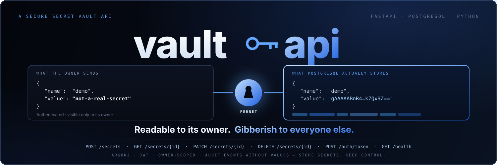
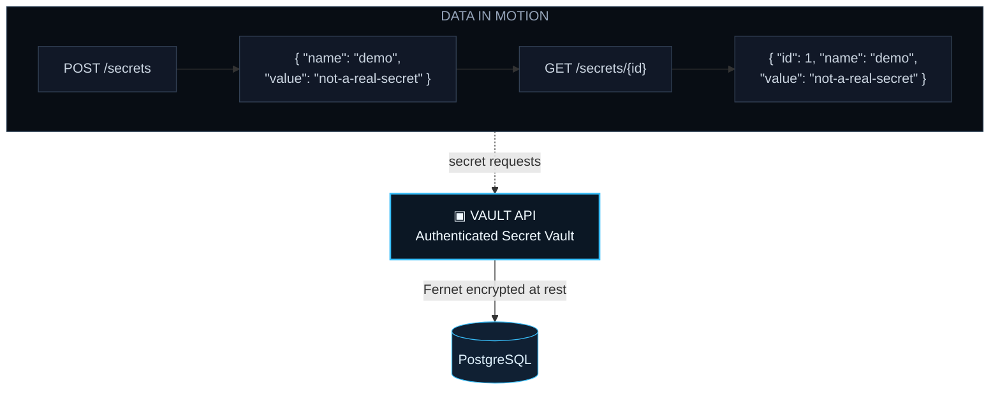
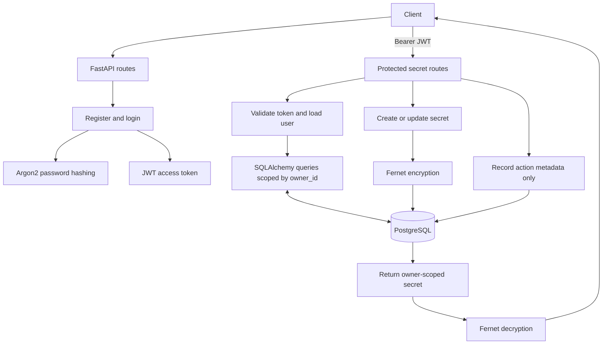

<p align="center">
  
</p>

<h1 align="center">MugdhoAI / <a href="https://github.com/MugdhoAI/vault-api">vault-api</a></h1>

<p align="center">
  <a href="https://github.com/MugdhoAI/vault-api/actions/workflows/ci.yml"></a>
  <a href="https://github.com/MugdhoAI/vault-api/actions/workflows/codeql.yml"></a>
  <a href="https://github.com/MugdhoAI/vault-api/blob/main/LICENSE"></a>
  
</p>

<p align="center">
  <strong>Store secrets. Keep control.</strong><br>
  A learning-focused FastAPI service for authenticated, owner-scoped secret storage. Secret values are encrypted with Fernet before being persisted to PostgreSQL.
</p>



**Status:** This is a learning and portfolio project, not production ready. Do not store real credentials or sensitive data in it.

## Why this project exists

Vault API is a hands-on way to study the full lifecycle of a sensitive backend resource: authentication, per-user authorization, encryption at rest, schema migrations, key rotation, and audit events. The focus is on making those controls visible in code and tests, not claiming production-grade vault security.

## What it demonstrates

* User registration and authentication
* Authorization and per-user data isolation
* Encryption of secret values before database persistence
* Asynchronous database access with SQLAlchemy
* Request validation and predictable API errors
* PostgreSQL-backed integration testing
* Containerized local development and CI

## Stack

* Python 3.12+ (CI tested on 3.12, 3.13, and 3.14)
* FastAPI
* PostgreSQL
* SQLAlchemy 2
* Pydantic
* Argon2
* JWT
* Fernet encryption
* pytest
* Docker
* GitHub Actions

## Quickstart

Requirements: Docker and Docker Compose.

Clone the repository and start the local development stack:

```bash
git clone https://github.com/MugdhoAI/vault-api.git
cd vault-api
docker compose up --build
```

When the containers are healthy, open [the interactive API docs](http://localhost:8000/docs). Use only test accounts and non-sensitive example values. The local Compose configuration contains development credentials and is not suitable for deployment.

## Architecture



## API

| Method | Endpoint | Purpose |
| --- | --- | --- |
| GET | `/health` | Check service and database availability |
| POST | `/auth/register` | Create a user and return an access token |
| POST | `/auth/token` | Authenticate an existing user |
| POST | `/secrets` | Store an encrypted secret |
| GET | `/secrets` | List the authenticated user's secrets |
| GET | `/secrets/{secret_id}` | Return one secret owned by the authenticated user |
| PATCH | `/secrets/{secret_id}` | Update a secret |
| DELETE | `/secrets/{secret_id}` | Delete a secret |

FastAPI exposes interactive API documentation at `/docs` while the application is running.

### Example workflow

The examples below assume the API is running at `http://localhost:8000` and that `curl` and Python are installed. Use a test account and non-sensitive values.

Register a user and save the returned access token:

```bash
TOKEN=$(curl --fail-with-body --silent --show-error \
  -X POST http://localhost:8000/auth/register \
  -H "Content-Type: application/json" \
  -d '{"email":"demo@example.com","password":"change-this-demo-password"}' \
  | python -c 'import json, sys; print(json.load(sys.stdin)["access_token"])')
```

If the account already exists, obtain a token through the login endpoint instead:

```bash
TOKEN=$(curl --fail-with-body --silent --show-error \
  -X POST http://localhost:8000/auth/token \
  -H "Content-Type: application/json" \
  -d '{"email":"demo@example.com","password":"change-this-demo-password"}' \
  | python -c 'import json, sys; print(json.load(sys.stdin)["access_token"])')
```

Create a secret. The response contains its numeric `id` and the decrypted value for the authenticated owner:

```bash
SECRET_ID=$(curl --fail-with-body --silent --show-error \
  -X POST http://localhost:8000/secrets \
  -H "Authorization: Bearer $TOKEN" \
  -H "Content-Type: application/json" \
  -d '{"name":"demo","value":"not-a-real-secret"}' \
  | python -c 'import json, sys; print(json.load(sys.stdin)["id"])')
```

Retrieve the secret and list the current user's secrets:

```bash
curl --fail-with-body --silent --show-error \
  http://localhost:8000/secrets/$SECRET_ID \
  -H "Authorization: Bearer $TOKEN"

curl --fail-with-body --silent --show-error \
  http://localhost:8000/secrets \
  -H "Authorization: Bearer $TOKEN"
```

These commands create persistent test data in the configured database. Use a disposable local database when experimenting.

## Security model

Passwords are hashed with Argon2 rather than stored as plain text. Secret values are encrypted before they are persisted to PostgreSQL. The application scopes secret queries to the authenticated user's ID, and does not grant access to another user's records just because a valid token is supplied.

The API decrypts a secret when returning it to its authenticated owner. This is server-side encryption, not end-to-end encryption.

Authentication and secret-management responses include `Cache-Control: no-store` so clients and intermediaries are instructed not to cache access tokens or decrypted secret values.

Successful secret creation, listing, retrieval, updates, and deletion are recorded in `audit_events` with the action, user ID, secret ID when applicable, and timestamp. Secret values are not included in these events. Authentication attempts are not currently audited.

The Docker Compose configuration contains credentials and an encryption key intended only for local development. Do not reuse these values in a deployed environment. Use unique secrets supplied through an appropriate secret manager or deployment configuration.

The encryption key is required to decrypt stored values. Losing all keys that can decrypt existing values can make those values unrecoverable. Back up the database and key material before rotating keys.

### Rotate the encryption key

1. Back up the database and securely preserve the current key.
2. Generate a new Fernet key and set it as `ENCRYPTION_KEY`.
3. Set `ENCRYPTION_KEY_PREVIOUS` to the old key. Multiple previous keys can be comma separated.
4. In a maintenance window, run `python scripts/rotate_encryption_key.py` once. The command re-encrypts stored values in a transaction using the new primary key.
5. Verify that stored values can be retrieved, then remove the old key from `ENCRYPTION_KEY_PREVIOUS` and restart the application.

Do not remove the previous key before the rotation command completes successfully. Keep the backup until verification is complete.

## Configuration

The application reads configuration from environment variables and, for local development, a `.env` file. Start with [`.env.example`](.env.example). It lists the required settings:

| Variable | Purpose |
| --- | --- |
| `DATABASE_URL` | PostgreSQL connection string using the async SQLAlchemy driver |
| `JWT_SECRET` | Secret used to sign access tokens |
| `ENCRYPTION_KEY` | Current Fernet key used for new encryption |
| `ENCRYPTION_KEY_PREVIOUS` | Optional comma separated previous Fernet keys accepted during key rotation |
| `RATE_LIMIT_STORAGE_URI` | Rate limit storage. Use `memory://` locally and Redis in production |
| `ENVIRONMENT` | Set to `development` locally or `production` to enable production secret validation |

For a local non-Docker run, copy the example file and replace the placeholder values:

```bash
cp .env.example .env
```

Generate a JWT signing secret with Python:

```bash
python -c "import secrets; print(secrets.token_urlsafe(48))"
```

Generate a Fernet encryption key:

```bash
python -c "from cryptography.fernet import Fernet; print(Fernet.generate_key().decode())"
```

Keep `.env` private and do not commit real credentials. Production secrets must be supplied by your deployment's secret management mechanism, not copied from the example or Docker Compose file. In production, configure `DATABASE_URL` with PostgreSQL TLS enabled, for example by adding `?ssl=require` to the connection URL. The application rejects production database URLs that do not specify TLS.

## Run locally

Create a virtual environment and install the development dependencies:

```bash
python -m venv .venv
pip install -e ".[dev]"
```

Start PostgreSQL and the API with Docker:

```bash
docker compose up --build
```

The API will be available at `http://localhost:8000`. Open `http://localhost:8000/docs` for the interactive API documentation. The local API and PostgreSQL ports are bound to loopback and are not exposed on other network interfaces by default. The API container runs as a non-root user and includes a health check. Docker Compose provides its own local development environment variables; it does not use values from `.env.example`.

For a non-Docker setup, PostgreSQL must be running separately. Copy `.env.example` to `.env`, configure the connection string and generated secrets, then apply the database migrations before starting the API:

```bash
alembic upgrade head
uvicorn app.main:app --reload
```

New Docker containers apply migrations before the API starts. The application no longer creates tables automatically at startup.

If you have a database created by an older version that used automatic table creation, back it up first. Do not run the initial migration against tables that already exist. After confirming that the existing `users` and `secrets` tables exactly match the initial migration, mark that baseline with `alembic stamp 0001_initial_schema`, then run `alembic upgrade head` to create the audit table. Do not stamp `head` directly on the old schema because that would skip the audit table migration. If the schema differs, create a fresh database and migrate it, or prepare a reviewed data migration first.

## Testing

Run the test suite:

```bash
pytest
```

Run static checks with Ruff:

```bash
ruff check .
```

Tests cover password hashing, token handling, configuration validation, encryption and key rotation, duplicate registration, invalid credentials, database health, secret CRUD operations, owner isolation, and request schema validation. CI runs Ruff, `pip-audit`, Docker image and Compose validation, and the PostgreSQL-backed test suite on Python 3.12, 3.13, and 3.14. CodeQL analyzes the Python code on pushes to `main` and pull requests targeting `main`.

## Current limitations

**This project is not production ready.** It is a learning and portfolio project that demonstrates a core authenticated secret storage API. A passing test suite does not establish production readiness.

Known gaps include:

* Authentication endpoints are rate limited. Production requires a Redis backed store; authentication attempts are not recorded in the audit log.
* Key rotation is an operator run procedure. Automated key recovery and external key management are not provided.
* Production deployment hardening, including TLS termination, operational monitoring, backup and restore validation, and deployment-specific secret management, has not been established by this repository.

The audit log records action names, user IDs, secret IDs, and timestamps. It does not store secret values. Local development uses an in-memory rate limit store, which is not shared across workers or instances. Configure Redis for production and test the deployment's proxy and client IP handling before relying on the limit.

These remaining gaps should be addressed and tested before considering a real deployment with sensitive data.

## Project structure

```text
app/                    API routes, configuration, security, crypto, and data models
migrations/             Versioned database schema migrations
scripts/                Operator-run encryption key rotation
tests/                  Authentication, configuration, crypto, rotation, and API tests
.github/workflows/      CI and CodeQL workflows
.env.example            Local configuration template
Dockerfile
docker-compose.yml
alembic.ini
pyproject.toml
CONTRIBUTING.md
SECURITY.md
LICENSE
```

## License

MIT
